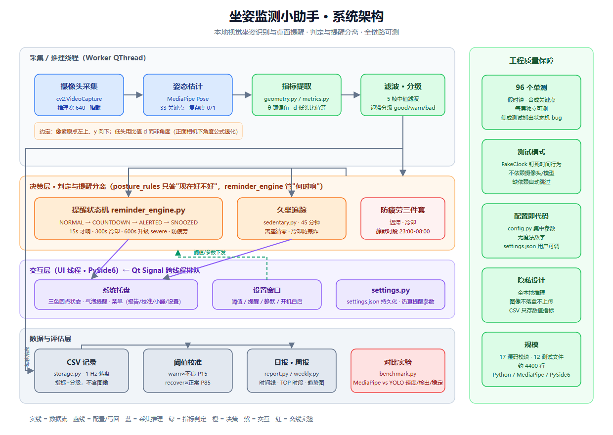
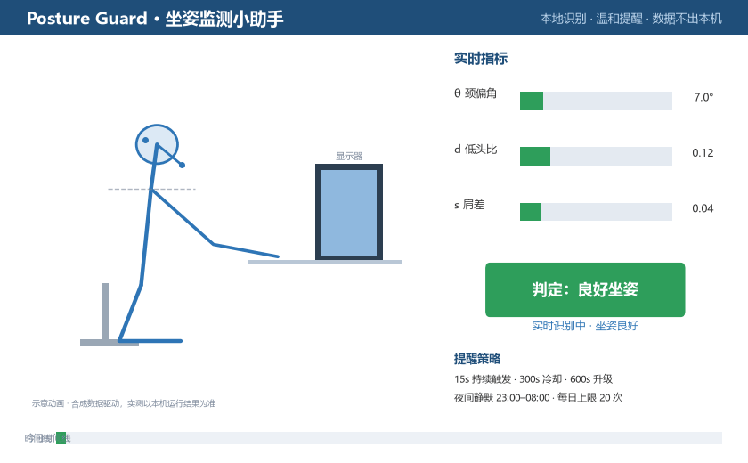

# 坐姿监测小助手（Posture Guard）

[](https://github.com/Person-lhy/posture-guard/actions/workflows/ci.yml)
[](LICENSE)


> 本地视觉坐姿识别与桌面提醒系统 —— 摄像头实时识别坐姿，桌面气泡温和提醒，数据全程不出本机。
> 机器人工程本科个人项目：自用工具 / 简历项目 / 毕业设计答辩。
> 源码：github.com/Person-lhy/posture-guard

*A local-first webcam posture monitor: MediaPipe keypoints → geometric posture grading → gentle desktop reminders, with daily/weekly reports and data-driven threshold tuning. Privacy by design — no frames leave your machine.*

## 功能

- **实时识别**：MediaPipe Pose 33 关键点 → 颈偏角 / 低头比值 / 颈长比 / 俯仰角 / 肩差 5 项几何指标，好 / 警告 / 不良三级判定
- **智能提醒**：坏姿势持续 15 秒才弹气泡；300 秒冷却、夜间静默（23:00–08:00）、每日上限 20 次、小睡 30 分钟——宁可漏提醒，不可烦到关软件
- **久坐提醒**：坐满 45 分钟提示起身，离座自动清零
- **数据闭环**：每秒指标落盘 CSV → 每日报告（时间线 + 坏姿势 TOP 时段）→ 周报趋势 → 阈值校准（warn≈不良 P15 / recover≈正常 P85，无区分度拒绝给建议）→ 一键写回配置
- **工程配套**：设置窗口、开机自启（启动文件夹，不碰注册表）、108 个单元测试、MediaPipe vs YOLO 对比实验 harness、学习型分类器实验（纯 Python 逻辑回归）

## 架构



采集/推理（Worker 线程）→ 指标提取 → 滤波分级 → 决策（判定与提醒分离）→ PySide6 托盘交互；数据层独立成环（CSV → 校准 / 日报 / 周报）。

## 演示



*合成数据驱动的原理示意：坐姿变差 → 指标越线 → 满 15s 温和提醒一次 → 恢复。实机录屏见 Roadmap。*

## 快速开始

```bash
# Python 3.10 / 3.11，Windows
pip install -r requirements.txt

python app.py            # 启动后驻留系统托盘
python app.py 1          # 指定摄像头设备号
```

其他入口：

```bash
python pose_view.py      # 调试：骨架叠加 + 实时指标 HUD
python benchmark.py      # 姿态估计器对比实验（速度/检出率/稳定性）
python sync_bench.py     # 把最近一次 benchmark 结果同步进下方表格
python classifier.py --demo   # 学习型分类器实验（规则蒸馏 · 逻辑回归）
python make_demo_data.py # 生成合成演示数据
```

## 测试

```bash
python -m pytest tests/          # 或逐个运行
python tests/test_geometry.py
```

108 个单测覆盖几何计算、指标提取、滤波分级、提醒状态机、存储报告、阈值校准、分类器实验；时间行为用假时钟、姿态用合成关键点，**不依赖摄像头与重依赖即可回归**（CI 见 `.github/workflows/ci.yml`）。

## 实验结果（MediaPipe vs YOLO-Pose）

在本机跑完对比实验后执行 `python sync_bench.py`，下表自动更新：

<!-- BENCH:START -->
_尚未实测——运行 `python benchmark.py && python sync_bench.py` 后自动填入_
<!-- BENCH:END -->

学习型分类器实验（`python classifier.py --demo`）：以规则分级为参照标签，4 项指标训练纯 Python 逻辑回归，留出集报告准确率/F1 与规则一致率——口径是**规则蒸馏**，学习边界与规则边界的差异是观察对象。

## 项目结构

```
posture-guard/
├── .github/workflows/  # CI：pytest 矩阵（3.10/3.11 × Ubuntu/Windows）
├── app.py              # PySide6 托盘主程序（Worker QThread + 信号通信）
├── geometry.py         # θ/d/r/φ/s 纯函数角度计算
├── metrics.py          # 关键点 → 指标提取
├── posture_rules.py    # 中值滤波 + 迟滞分级（判定）
├── reminder_engine.py  # 提醒状态机（决策，与判定分离）
├── sedentary.py        # 久坐追踪
├── storage.py          # CSV 落盘 + 分布统计
├── report.py / weekly.py / autotune.py   # 日报 / 周报 / 阈值校准
├── settings.py         # 配置持久化 + 开机自启
├── benchmark.py        # MediaPipe vs YOLO 对比实验 harness
├── sync_bench.py       # benchmark 结果同步进 README 表格
├── classifier.py       # 学习型分类器实验（纯 Python 逻辑回归）
├── config.py           # 全部阈值与提醒参数
├── tests/              # 14 个测试文件，108 个单测
├── pyproject.toml      # 项目元数据 + pytest 配置
├── CHANGELOG.md        # 版本变更记录
├── LICENSE             # MIT
└── docs/
    ├── 细节规格.md      # 坐标系约定、指标定义、参数表
    ├── 答辩素材/        # 架构图、演示脚本、PPT 讲稿、FAQ
    └── 简历素材/        # 简历项目经历条目
```

## 设计要点（面试可聊）

1. **正面相机的低头指标**：侧视角度公式在正面视角退化（鼻耳同 x），改用比值 d = 鼻下移/肩宽，无量纲且自带尺度归一
2. **判定与提醒分离**：posture_rules 只回答"现在好不好"，reminder_engine 决定"何时发声"，两模块各自可独立测试
3. **阈值从数据标定**：锚定好坏姿势分布边界（P15/P85），分布重叠时**拒绝给建议**——给无区分度阈值等于装了误报制造器
4. **边界语义**：人离开、追踪丢失、数据缺失时如实报告 unknown，不用旧值续喂、不冻结计时

## Roadmap

- [ ] 本机实测 MediaPipe vs YOLO 对比数据，填入上方实验表（`python benchmark.py && python sync_bench.py`）
- [x] 原理示意动画（[demo.gif](docs/答辩素材/demo.gif)，合成数据驱动）；实机录屏 / GIF 待补
- [ ] 手工标注小样本集，报告 PCK / 角度误差（把"角度一致性"口径升级为"精度"口径）
- [ ] Web 版每日/每周报告（离线导出 HTML）

## 隐私

全程本地推理，无任何网络上传路径；图像帧用完即丢，CSV 只存数值指标与分级标签。

## License

[MIT](LICENSE)
